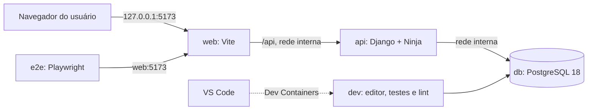
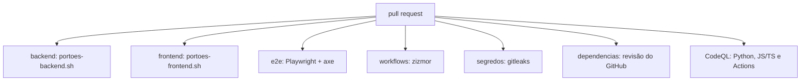

# Fundação do projeto Design

**Spec**: `.specs/features/fundacao/spec.md`
**Status**: Approved (2026-11-26, com a spec e as tarefas: "Aprovo, pode seguir")

---

## Architecture Overview

No computador do usuário, tudo roda em contêineres do Docker Compose. O navegador fala só com o servidor do Vite, na porta 5173; o Vite repassa `/api` para o Django, na rede interna do Compose. Assim, a página e a API ficam na mesma origem, como na produção (D-020), e o banco não fica exposto.



Os serviços `dev`, `api` e `web` usam a mesma imagem de desenvolvimento e os mesmos volumes, com o ambiente Python (`.venv`) e o `node_modules` dentro de volumes do Docker (seção 6.J.1). O `e2e` usa a imagem oficial do Playwright e só sobe com o perfil `e2e`.

O CI roda os mesmos comandos, nos mesmos contêineres:



---

## Code Reuse Analysis

O repositório só tem documentação; não há código a reaproveitar.

### Integration Points

| Sistema | Como a fundação se liga |
| --- | --- |
| PostgreSQL 18 | `psycopg` 3 pelo backend do Django; variáveis `PGHOST`, `PGDATABASE`, `PGUSER` e `PGPASSWORD`, com tempo de conexão de 2 s |
| OpenAPI do Django Ninja | `manage.py export_openapi_schema` grava `frontend/src/api/openapi.json`; o `openapi-typescript` gera `frontend/src/api/esquema.d.ts` |
| GitHub | Workflows em `.github/workflows/`, Dependabot, `SECURITY.md` e o modelo de pull request |

---

## Components

### Estrutura do repositório

```
.
├── .devcontainer/devcontainer.json
├── .github/
│   ├── workflows/ci.yml, dependencias.yml, codeql.yml
│   ├── zizmor.yml, dependabot.yml, pull_request_template.md
├── .gitattributes, .dockerignore
├── compose.yaml
├── docker/dev.Dockerfile
├── scripts/conferir-isolamento.sh, portoes-backend.sh, portoes-frontend.sh, conferir_contrato.py
├── SECURITY.md
├── backend/
│   ├── pyproject.toml, uv.lock, manage.py
│   ├── medteca/settings/base.py, dev.py, test.py, prod.py
│   ├── medteca/urls.py, api.py, wsgi.py, asgi.py
│   └── tests/test_saude.py, test_producao.py, repositorio/
└── frontend/
    ├── package.json, pnpm-lock.yaml, pnpm-workspace.yaml
    ├── index.html, vite.config.ts, tsconfig.json, eslint.config.js, .prettierrc.json, playwright.config.ts
    ├── src/main.tsx, PaginaInicial.tsx, SituacaoDoServidor.tsx (+ testes)
    ├── src/api/openapi.json, esquema.d.ts, cliente.ts
    └── e2e/pagina-inicial.spec.ts
```

### Imagem de desenvolvimento

- **Purpose**: Um contêiner com Python, uv, Node e pnpm, para o editor, os servidores e os comandos de teste.
- **Location**: `docker/dev.Dockerfile`
- **Interfaces**: `docker compose build dev`
- **Dependencies**: imagens oficiais `python` e `node`, fixadas por digest; o `node` é copiado da imagem oficial dele para a do `python`, na mesma versão do Debian. O uv vem do PyPI e o pnpm, do registro do npm, com a versão fixada e `--ignore-scripts`.
- **Reuses**: nada.

Roda como usuário sem privilégio (`dev`, UID 1000). As pastas do `.venv` e do `node_modules` são criadas na imagem com esse dono, para que os volumes nasçam com a permissão certa. A `libatomic` que o Node exige vem da imagem oficial do Node. O `npm` e o `npx` saem da imagem depois de instalar o pnpm, e a política de dependências vale também para comandos avulsos: `PIP_REQUIRE_HASHES=1`, `UV_EXCLUDE_NEWER="7 days"`, `pnpm_config_minimum_release_age=10080` e `pnpm_config_strict_dep_builds=true`.

### Compose

- **Purpose**: Subir banco, API, frontend e editor com um comando.
- **Location**: `compose.yaml`
- **Interfaces**: `docker compose up`; `docker compose run --rm dev <comando>`; `docker compose --profile e2e run --rm e2e`.
- **Serviços**: `db` (PostgreSQL 18, sem porta publicada, com checagem de saúde por `pg_isready`); `dev` (`sleep infinity`, onde o VS Code se liga); `api` (`runserver 0.0.0.0:8000`); `web` (`vite --host 0.0.0.0`, a única porta publicada, `127.0.0.1:5173`); `e2e` (perfil `e2e`).
- **Montagens**: o repositório em `/workspace`, só para leitura, com escrita apenas em `backend/`, `frontend/` e `scripts/` (FUND-35); volumes nomeados para `.venv`, `node_modules` e os caches do uv e do pnpm. Nenhuma pasta do usuário, nenhuma variável de credencial (FUND-03). Os contêineres do ambiente rodam sem capacidades do Linux (`cap_drop: [ALL]`) e com `no-new-privileges`. Mudança da revisão independente da fase 1: com tudo gravável, código de terceiros podia gravar no `.git` e no `.claude` algo que o Windows executaria.
- **Pastas criadas pelo Docker**: quando o Docker cria uma pasta no Windows para montar um volume, ela nasce com dono `root` e o contêiner não grava nela; por isso `backend/` e `frontend/` têm um `.gitkeep` desde a fase 1.

### Backend

- **Purpose**: Projeto Django com a API do Django Ninja.
- **Location**: `backend/medteca/`
- **Interfaces**:
  - `GET /api/saude` → `200 {"situacao": "ok"}` ou `503 {"situacao": "indisponivel"}`, sempre com `Cache-Control: no-store`. Faz `SELECT 1` e trata `DatabaseError`.
  - `/api/docs` e `/api/openapi.json` só quando `MEDTECA_DOCS_DA_API` é verdadeiro (desenvolvimento e teste); na produção, `NinjaAPI(docs_url=None, openapi_url=None)`.
- **Configurações**: `base.py` (pt-BR, `America/Sao_Paulo`, `USE_TZ`, middlewares de segurança, banco pelas variáveis de ambiente); `dev.py` (depuração, segredo fictício, hosts `localhost`, `127.0.0.1` e `api`); `test.py` (a partir do `dev`); `prod.py` (sem depuração, segredo obrigatório por `DJANGO_SECRET_KEY`, hosts por `DJANGO_ALLOWED_HOSTS`, cookies seguros e avisos de HSTS e de redirecionamento silenciados com o motivo).
- **Dependencies**: Django 6.1, Django Ninja, psycopg 3; no grupo de desenvolvimento, pytest, pytest-django, Ruff, mypy, django-stubs, PyYAML (testes do repositório) e zizmor.

### Frontend

- **Purpose**: Página inicial que consulta `/api/saude`.
- **Location**: `frontend/src/`
- **Interfaces**:
  - `SituacaoDoServidor`: estados `verificando`, `no-ar` e `fora-do-ar`; chama `cliente.GET("/api/saude", { signal: AbortSignal.timeout(5000) })`; só `200` com `situacao === "ok"` conta como no ar; a mensagem fica num `<p role="status">`.
  - `PaginaInicial`: título "MedTeca" e a `SituacaoDoServidor`.
  - `cliente.ts`: `createClient<paths>({ baseUrl: "" })` do `openapi-fetch`, com os tipos de `esquema.d.ts`.
- **Vite**: repasse de `/api` para `http://api:8000`; `server.allowedHosts` com `web`, para o Playwright; observação de arquivos por varredura (`usePolling`), porque a pasta vem do Windows.
- **Dependencies**: React, React DOM, `openapi-fetch`; no desenvolvimento, Vite, TypeScript, ESLint (typescript-eslint, react-hooks, jsx-a11y), Prettier, Vitest, Testing Library, jsdom, `openapi-typescript`, Playwright e `@axe-core/playwright`. O React Aria entra com o sistema de design, quando houver o primeiro componente que o use.

### Checagem de contrato

- **Purpose**: Falhar quando a API e o cliente divergem (FUND-18).
- **Location**: `scripts/conferir_contrato.py`
- **Interfaces**: exporta o OpenAPI e gera os tipos numa pasta temporária e compara com `frontend/src/api/openapi.json` e `esquema.d.ts`; sai com 1 e mostra a diferença se algo mudou. Não usa o Git, que roda fora dos contêineres (seção 6.J.1).

### Portões locais

- **Location**: `scripts/portoes-backend.sh` e `scripts/portoes-frontend.sh`
- **Interfaces**: rodam, em sequência, os portões de cada lado, e o CI chama os mesmos scripts. O usuário roda o mesmo que o CI com um comando.

### CI

- **Location**: `.github/workflows/`
- **ci.yml** (pull request e push na `main`): jobs `backend`, `frontend`, `e2e`, `workflows` (zizmor) e `segredos` (gitleaks pela imagem do projeto, sobre todo o histórico), cada um montando a imagem de desenvolvimento e rodando os scripts dentro dela. `permissions: {}` no topo e `contents: read` nos jobs. O relatório do Playwright só sobe quando falha, guardado por 14 dias.
- **dependencias.yml** (pull request): revisão de dependências do GitHub com `fail-on-severity: high` e a lista de licenças da seção 6.E.7.
- **codeql.yml** (pull request, push na `main` e semanal): Python, JavaScript/TypeScript e Actions, sem compilação; `security-events: write` só nesse job.

---

## Error Handling Strategy

| Error Scenario | Handling | User Impact |
| --- | --- | --- |
| Banco fora do ar | `DatabaseError` em `/api/saude` vira 503 com corpo fixo, sem detalhe | Página mostra "Servidor fora do ar" |
| API fora do ar ou lenta | Erro de rede ou `AbortSignal.timeout(5000)` | Página mostra "Servidor fora do ar" |
| Segredo ausente na produção | `ImproperlyConfigured` ao carregar `prod.py` | O processo não sobe |
| Lockfile desatualizado | `uv sync --locked` e `pnpm install --frozen-lockfile` falham | A instalação para, e o lockfile fica como estava |

---

## Risks & Concerns

| Concern | Location | Impact | Mitigation |
| --- | --- | --- | --- |
| O Git está com `core.autocrlf=true` no Windows; scripts com CRLF quebram no Linux e o Prettier acusa os arquivos | `.gitattributes` | Scripts e portões falham só no computador do usuário | `* text=auto eol=lf` no `.gitattributes` (T1) |
| O VS Code, por padrão, copia o `.gitconfig` e repassa as credenciais do Git para o contêiner | `.devcontainer/devcontainer.json` | Credenciais dentro do contêiner, contra o RNF-85 | Essas opções são configurações do usuário no VS Code, não do repositório; o pull request da fase 1 traz o passo a passo, e o FUND-34 prova o resultado. Commits e push continuam pelo Windows |
| Mudanças em arquivos montados do Windows não chegam ao contêiner como eventos | `vite.config.ts` | O Vite não recarrega sozinho | `usePolling`; a V43 mede o custo |
| `strictDepBuilds` pode barrar dependências com script de instalação | `pnpm-workspace.yaml` | A instalação falha | Cada liberação é perguntada ao usuário e registrada (seção 6.E.3) |
| Relato de falha do `exclude-newer` relativo do uv com `uv sync --locked` (V37) | `backend/pyproject.toml` | A instalação pode falhar | Testar na fase 2; se falhar, levar ao usuário a alternativa de data fixa |
| Volumes nomeados nascem com dono `root` | `docker/dev.Dockerfile` | Sem permissão para instalar como `dev` | Criar as pastas na imagem com o dono `dev` |
| O Docker Desktop estava instalado (cliente 29.6.1) mas parado em 2026-11-26 | Computador do usuário | Nada roda | O usuário abre o Docker Desktop antes da fase 1 |

---

## Tech Decisions

| Decision | Choice | Rationale |
| --- | --- | --- |
| Onde rodam lint e testes | Sempre dentro do contêiner `dev`, local e no CI, pelos mesmos scripts | Mesmo resultado nos dois lugares; seção 6.J.1 e "Tudo roda em contêineres" (seção 6.D) |
| Testes das configurações de produção | Subprocesso com `DJANGO_SETTINGS_MODULE=medteca.settings.prod` | A `NinjaAPI` é montada na importação; trocar configurações dentro do mesmo processo não testaria o que a produção carrega |
| Testes da configuração do repositório | pytest lendo `compose.yaml`, workflows, `dependabot.yml`, `pnpm-workspace.yaml` e `pyproject.toml` | Um teste por critério, com nome que cita o ID (D-026), em vez de confiar só nas ferramentas |
| Escopo do gitleaks no CI | Todo o histórico, em cada execução | O repositório é pequeno, e um segredo antigo também conta como exposto (seção 6.G.2) |
