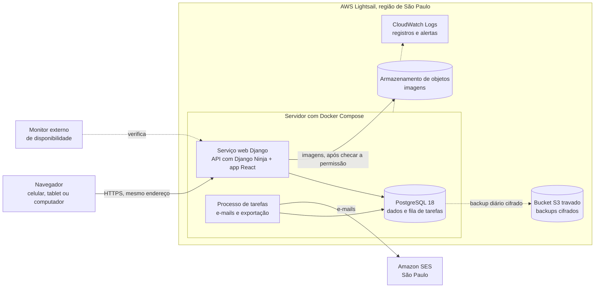

# MedTeca

Plataforma web de questões para estudantes de medicina, com conteúdo rastreável, revisado por pessoas e transparente sobre a origem de cada gabarito.

> **Situação: preparando a implementação.** O planejamento foi aprovado até a Etapa 6, e a primeira funcionalidade, a fundação do projeto, está especificada em `.specs/features/fundacao/`. Ainda não há código implementado nem versão em uso. Esta página reflete a situação de 26/11/2026. A fonte da verdade sobre o que está decidido é o [registro de decisões](docs/decisions.md).

## Visão geral

O MedTeca é uma plataforma para praticar questões no estilo das provas de residência médica, organizadas por grande área e tema.

O projeto nasceu de uma necessidade concreta: ter uma ferramenta de estudo em que o estudante possa confiar. O objetivo é que ele prefira o MedTeca às alternativas por três motivos:

- pela confiabilidade do conteúdo;
- pela experiência de uso;
- pelo preço justo.

O lançamento começa por um **beta fechado, por convite e sem data fixa** ([D-001](docs/decisions.md), [D-021](docs/decisions.md)). A abertura ao público só acontece depois de resolvidas duas questões: a situação jurídica do conteúdo e a política de revisão clínica (D-002 e D-003). A cobrança vem depois da abertura.

## Público-alvo e problemas

**Público inicial:** estudantes de medicina do ciclo clínico em diante, que estudam com questões de residência organizadas por tema e usam principalmente celular e tablet (D-013).

**Problemas que o MedTeca pretende resolver:**

- **Preço alto** e funcionalidades travadas em planos premium.
- **Desconfiança no conteúdo:** gabaritos e comentários sem fonte verificável ou gerados por IA sem revisão.
- **Interfaces genéricas** e pouco agradáveis, especialmente no tablet.

## Proposta de valor

Aprovada em [D-014](docs/decisions.md):

- **Transparência do conteúdo.** Cada questão mostra a origem, a situação do gabarito e a revisão que recebeu.
- **Experiência de aplicativo no celular e no tablet**, com interface própria, fluida e acessível.
- **Preço justo**, sem funcionalidades bloqueadas por plano.

O MedTeca não compete em volume de questões nem em inteligência artificial. O diferencial é a confiança no que é publicado e a qualidade da experiência.

## Funcionalidades planejadas para o MVP

Este é o escopo aprovado em D-001, detalhado com critérios testáveis no [catálogo de requisitos](docs/requisitos-mvp.md). **Nenhuma destas funcionalidades está implementada ainda.**

**Para estudantes**

- Conta criada por convite durante o beta, com login por e-mail e senha e recuperação de senha.
- Questões organizadas por grande área e tema, com filtros por área, tema, banca, ano, questões não resolvidas e questões erradas.
- Treino por tema, com correção imediata.
- Simulado cronometrado, com pausa e correção no fim.
- Riscar alternativas enquanto resolve, para eliminar opções, no treino e no simulado (D-031).
- Lista de erros e questões marcadas para revisar.
- Desempenho por área e tema. Os temas mais fracos aparecem em destaque, e cada taxa de acerto mostra quantas respostas entraram no cálculo.
- Botão para reportar erro numa questão, com resposta ao estudante.
- Termos de uso, política de privacidade, exportação dos dados e exclusão da conta.

**Para a equipe editorial**, num painel usado no computador:

- Cadastro de questões com origem, autorização de uso, referências, imagens e versões.
- Revisão obrigatória antes de publicar, feita por pessoa diferente do autor.
- Retirada de circulação de questões anuladas, desatualizadas ou com problema, com registro do motivo.
- Fila de reportes de erro enviados pelos estudantes.

**Fora do MVP:**

- importação em lote;
- busca por texto livre;
- comparação com outros alunos;
- pagamentos;
- comentários de alunos;
- organização de estudos;
- revisão espaçada;
- ranking;
- chatbot com IA;
- app nativo.

## Arquitetura e tecnologias

Escolhas aprovadas na Etapa 3. O raciocínio de cada uma está no [registro de decisões](docs/decisions.md) e nos [ADRs](docs/adr/).

| Camada | Escolha | Decisão |
|---|---|---|
| Arquitetura | Frontend React que conversa com uma API em Python, servidos juntos como um único serviço, no mesmo endereço | D-020 |
| Backend | Python com Django e Django Ninja | D-004 |
| Frontend | React com TypeScript | D-006 |
| Componentes de interface | React Aria Components, que cuidam da acessibilidade sem impor visual; o sistema visual é próprio do MedTeca | D-006 |
| Banco de dados | PostgreSQL 18 no próprio servidor, sem porta de rede, com os dados num disco cifrado | D-005, D-033 |
| Autenticação | Sessão do Django em cookie protegido, proteção contra CSRF obrigatória e senhas de 15 caracteres ou mais, guardadas com Argon2id e conferidas contra vazamentos; segundo fator obrigatório para a equipe, com passkey | D-007 |
| Infraestrutura | Um servidor AWS Lightsail em São Paulo, com Docker Compose, descrito como código (OpenTofu) | D-010, D-033 |
| Imagens | Armazenamento de objetos privado em São Paulo | D-022 |
| E-mail | Amazon SES em São Paulo | D-023 |
| Tarefas em segundo plano | Fila no próprio PostgreSQL | D-024 |
| Registros e monitoramento | Registros também no AWS CloudWatch Logs em São Paulo, com alertas fora do servidor, e monitor externo de disponibilidade; erros sem serviço externo | D-032 (substitui D-025) |
| Segredos e acesso à AWS | Segredos no AWS Systems Manager Parameter Store; acesso à AWS por certificado com credenciais temporárias (IAM Roles Anywhere) | D-033 |
| Backups | Diários, cifrados e travados contra exclusão por 30 dias num bucket S3 em São Paulo | D-033 |
| Deploy | Imagem testada no CI e publicada no ECR em São Paulo; troca por comando, sem queda para o estudante | D-027, D-033 |
| Testes | pytest, Vitest, Playwright e axe-core, com verificação rastreável por requisito | D-026 |
| Integração contínua | GitHub Actions | D-027 |
| Qualidade e cadeia de suprimentos | Toda mudança por pull request, com revisão do código e merge manual pelo usuário; dependências com lockfile e espera de 7 dias; inventário (SBOM) de cada imagem; CodeQL, varredura de segredos e OWASP ZAP | D-034 |
| Idioma | Interface em português do Brasil | D-016 |

As versões exatas das bibliotecas são fixadas no início da implementação.

## Organização dos componentes

O diagrama abaixo é conceitual. Não representa estrutura de pastas nem configuração.

- **O app é carregado uma vez.** Depois disso, as telas mudam no próprio aparelho, e os dados vêm da API. A próxima questão é carregada antes do toque, para a troca ser rápida.
- **O estado de trabalho é preservado.** Se a conexão cair durante o simulado, o aparelho guarda as respostas e as envia quando ela voltar. A ordem do treino se mantém ao recarregar a página, e o cronômetro continua ao girar a tela.
- **As regras de permissão são aplicadas no backend.** Por padrão, toda ação é negada.
- **As imagens das questões não ficam públicas.** O app só as entrega depois de checar a permissão, o que permite deixar de exibir as de questões retiradas.

## Princípios

### Integridade do conteúdo médico

**O MedTeca não apresenta conteúdo médico inventado ou não verificado como conhecimento confiável.** Um gabarito errado ensina errado a quem vai tratar pacientes. Por isso:

- **Origem e situação do gabarito ficam visíveis.** Cada questão informa de onde vem a resposta: publicada oficialmente pela banca, definida por uma pessoa quando não há gabarito oficial, ou ainda preliminar. Um gabarito preliminar é sempre sinalizado, e o acerto ou erro baseado nele aparece como provisório.
- **Autorizar o uso e comprovar o gabarito são coisas diferentes.**
  - A autorização para reproduzir o conteúdo exige evidência documental atestada pelo administrador.
  - O gabarito oficial exige a referência ao documento da banca.
  - Uma não substitui a outra. Conteúdo sem autorização comprovada não é publicado, nem no beta.
- **Nada é publicado sem revisão humana**, feita por pessoa diferente do autor. Comentários precisam citar ao menos uma referência.
- **O histórico de versões é preservado.** Uma questão publicada não é editada por cima: qualquer mudança de conteúdo gera uma nova versão, que precisa de revisão. Cada resposta fica ligada à versão e ao gabarito que o estudante viu.
- **Toda correção é rastreável.** Cada alteração registra quem fez, quando, o que mudou e por quê. Quando o gabarito muda, o desempenho de quem respondeu é recalculado, e essas pessoas são avisadas.
- **Retirar uma questão não apaga o histórico.** Questões anuladas, desatualizadas ou com problema saem de circulação, mas as respostas já dadas são preservadas. Quando a retirada é por licenciamento, o conteúdo deixa de ser exibido também no histórico.
- **Dados de teste são fictícios e marcados.** Nunca há conteúdo clínico inventado, nem para testar.

O uso de IA para gerar ou revisar conteúdo ainda não foi decidido (D-012) e não faz parte do MVP.

### Privacidade e segurança

- **Dados no Brasil:** servidor, banco de dados, imagens e envio de e-mail ficam na região de São Paulo.
- **Coleta mínima:** e-mail, senha e, opcionalmente, um apelido.
- **Direitos sobre os próprios dados:** o estudante pode exportá-los e excluir a conta. Depois da exclusão, as respostas viram só contagens por alternativa, sem nenhuma resposta individual, para a estatística das questões. Contas paradas são excluídas após 24 meses sem uso, com aviso 30 dias antes.
- **Privacidade dentro da equipe:** editores e revisores veem números agregados, só com 10 pessoas ou mais, nunca as respostas individuais dos estudantes; o editor não vê quem enviou um reporte.
- **Sessões e permissões:**
  - sessão em cookie protegido;
  - proteção contra CSRF obrigatória;
  - senhas guardadas com Argon2id;
  - permissões negadas por padrão e aplicadas no backend.
- **Logs sem segredos:** nunca registram senhas, tokens ou credenciais, e identificam o usuário por um código interno.
- **Registros fora do servidor:** os registros vão também para o CloudWatch Logs em São Paulo. Os de segurança ficam 6 meses, com IP; os do app, 30 dias, sem IP. Os alertas funcionam mesmo com o servidor fora do ar (D-032).
- **Backups:** diários, cifrados e travados contra exclusão por 30 dias num bucket em São Paulo, com teste mensal que restaura de fato uma cópia (D-033).
- **Servidor fechado:** banco sem porta de rede, SSH aberto só sob demanda e segredos no cofre da AWS, fora do disco (D-033).

A segurança e a privacidade foram definidas na Etapa 6. As contas e o acesso (D-007, bloco 1), as permissões e a privacidade (bloco 2), o tratamento de dados pessoais pela LGPD (D-009, bloco 3), os registros e o monitoramento (D-032), a infraestrutura e a operação (D-033) e a qualidade e a cadeia de suprimentos (D-034) já foram aprovados e estão em [docs/seguranca-e-privacidade.md](docs/seguranca-e-privacidade.md).

### Acessibilidade

- **Meta de conformidade:** WCAG 2.2 nível AA.
- **Componentes:** React Aria Components, que cuidam do comportamento para teclado, toque e leitor de tela.
- **Testes:** automáticos com axe-core, mais checagem manual com VoiceOver, TalkBack, teclado e leitores de tela em computadores.
- **Imagens das questões**, classificadas em três tipos:
  - **informativas:** o texto alternativo descreve o conteúdo;
  - **objeto de avaliação:** o texto alternativo identifica a imagem sem interpretar os achados, para não entregar a resposta. É uma exceção que a WCAG prevê para testes;
  - **decorativas:** ignoradas pelos leitores de tela.

## Situação atual

Situação em 26/11/2026:

| Etapa | Situação |
|---|---|
| 1. Descoberta do produto | Concluída |
| 2. Requisitos do MVP | Aprovada |
| 3. Arquitetura e tecnologias | Aprovada |
| 4. Modelagem conceitual dos dados | Aprovada |
| 5. Identidade visual, UX e fluxos de navegação | Aprovada |
| 6. Segurança, qualidade e infraestrutura | Aprovada em 26/11/2026: contas e acesso, permissões e privacidade, LGPD, registros e monitoramento, infraestrutura e operação, qualidade e cadeia de suprimentos. As verificações técnicas e as questões jurídicas seguem abertas e impedem o beta, não a implementação |
| 7. Preparação para implementação | Resumida à ordem de construção (D-036) e à spec da fundação, aprovadas em 26/11/2026; a fundação está em implementação |

**Decisões ainda pendentes:**

| ID | Tema |
|---|---|
| D-002 | Origem das questões e licenciamento |
| D-003 | Revisão do conteúdo clínico |
| D-011 | Modelo de negócio e cobrança |
| D-012 | Uso de IA no conteúdo |
| D-015 | Meta de acervo e operação de conteúdo do beta |

A situação atualizada de cada decisão está sempre no [registro de decisões](docs/decisions.md).

## Roadmap

1. **Descoberta do produto:** público, problemas, proposta de valor e escopo do MVP.
2. **Requisitos:** catálogo de requisitos funcionais e não funcionais, com critérios testáveis.
3. **Arquitetura e tecnologias:** estilo de arquitetura, stack, hospedagem, testes e integração contínua.
4. **Modelagem conceitual dos dados:** questões, versões, gabaritos, tentativas e rastreabilidade.
5. **Identidade visual, UX e fluxos:** sistema visual próprio, componentes, navegação e responsividade.
6. **Segurança, qualidade e infraestrutura:** proteção do servidor, LGPD, permissões, backups e operação.
7. **Preparação para implementar:** ordem de construção das funcionalidades e spec da fundação.

**Depois do planejamento:**

- **Implementação por funcionalidade.** Cada funcionalidade ganha uma especificação própria, testes e aprovação antes de ser construída (D-017). A implementação só começa com autorização explícita.
- **Beta fechado** por convite, sem data fixa (D-021), apenas com conteúdo de autorização comprovada (D-019).
- **Abertura ao público** depois de resolvidas a origem e o licenciamento do conteúdo (D-002) e a revisão clínica (D-003). A cobrança vem depois.

## Documentação

| Documento | Conteúdo |
|---|---|
| [docs/decisions.md](docs/decisions.md) | Registro de decisões: índice com a situação de cada decisão. Só as decisões aprovadas são vinculantes |
| [docs/requisitos-mvp.md](docs/requisitos-mvp.md) | Catálogo de requisitos do MVP, com critérios no formato EARS e IDs rastreáveis (por exemplo, CONT-13) |
| [docs/modelo-conceitual.md](docs/modelo-conceitual.md) | Modelo conceitual dos dados: entidades, relações, regras de integridade e rastreabilidade até os requisitos |
| [docs/design-e-ux.md](docs/design-e-ux.md) | Identidade visual, sistema de design, tom de voz, navegação, fluxos e tamanhos de tela, com os requisitos atendidos por tela |
| [docs/design/](docs/design/) | Referência visual da Etapa 5: identidade, sistema de design e navegação, em páginas HTML para abrir no navegador. Não é código do app |
| [docs/seguranca-e-privacidade.md](docs/seguranca-e-privacidade.md) | Segurança e privacidade da Etapa 6, por bloco: contas e acesso (bloco 1), permissões e privacidade (bloco 2), LGPD (bloco 3), registros e monitoramento (bloco 4), infraestrutura e operação (bloco 5) e qualidade e cadeia de suprimentos (bloco 6), com as autorizações recorrentes, as verificações, as questões jurídicas e as inconsistências já resolvidas |
| [docs/adr/](docs/adr/) | Registros de decisões de arquitetura (ADRs) com o raciocínio completo das decisões mais importantes. Cada ADR tem link no registro de decisões |

As decisões passam por estes estados: **Pendente → Proposta → Aprovada → Substituída**, e as propostas recusadas ficam como **Descartada**. Cada requisito tem um ID; a especificação de cada funcionalidade e os seus testes citam esse ID, ligando o que foi pedido ao que foi verificado (D-026).
