# Modelo conceitual dos dados: MedTeca

**Situação**: aprovado. Etapa 4 encerrada.

**Aprovado**: 2026-11-23 - usuário: "Aprovar Etapa 4"

Modelo conceitual dos dados do MVP: as entidades, as relações entre elas, os atributos principais e as regras que os dados precisam respeitar, cada uma ligada aos requisitos de `docs/requisitos-mvp.md`. Tabelas, tipos, índices e SQL não entram aqui: são modelo físico e ficam para a implementação, com o banco aprovado em D-005 (PostgreSQL).

## Convenções

- **Decisões de modelagem** recebem IDs `M-NN`.
- **Situação de cada decisão**:
  - **Derivada**: consequência direta de requisitos ou decisões já aprovados; a fonte cita quais.
  - **Confirmada**: escolhida pelo usuário numa resposta; a fonte traz a resposta e a data.
  - **Proposta**: escrita pelo consultor e aguardando o usuário.
  - **Pendente**: a pergunta existe e ainda não tem resposta.
  - **Substituída**: trocada, no todo ou em parte, por uma decisão mais nova, que é citada. Nunca é apagada.

## Mapa preliminar das entidades

Mapa inicial, usado para orientar as perguntas. A versão final está no diagrama da seção "Síntese".

| Grupo | Entidades |
|---|---|
| Conteúdo | Questão, Versão da questão, Alternativa, Situação do gabarito e o histórico dela, Referência, Imagem, Sistema de classificação e seus níveis, Origem (prova da banca ou autor), Autorização de uso com evidência |
| Fluxo editorial | Revisão, Retirada, Reporte, Evento editorial (trilha de auditoria) |
| Estudo | Sessão de treino, Simulado, Tentativa, Marcação |
| Pessoas | Conta, Papel, Convite, Aceite dos termos |
| Desempenho | Derivado das tentativas (forma em aberto no bloco 2) |

## Bloco 1: identidade, versões e classificação

| ID | Decisão | Situação | Fonte |
|---|---|---|---|
| M-01 | **Questão** e **Versão da questão** são entidades separadas. A questão é a identidade estável; cada versão guarda um conteúdo (enunciado, alternativas, gabarito, comentário, referências, imagens) que nunca é editado depois de publicado. As respostas apontam para a versão respondida. | Derivada | FLUXO-04, CONT-13, CONT-18 |
| M-02 | A **versão vigente**, a que os estudantes veem, é indicada pela própria questão, e não por um status a mais. A versão continua tendo só os quatro status do FLUXO-01 (rascunho, em revisão, publicada, retirada). A versão anterior segue vigente enquanto a nova está em revisão. | Derivada | FLUXO-01, FLUXO-05, FLUXO-06 |
| M-03 | As **alternativas têm identidade estável** dentro da questão: cada uma tem um identificador que não muda entre versões. O gabarito e as respostas apontam para esse identificador, e não para a letra exibida, o que mantém o recálculo correto entre versões. Quais alternativas cada versão usa, e em que ordem, é definido em M-30. | Substituída em parte por M-30 | Resposta "Identidade estável" (2026-11-23); serve a CONT-09, CONT-15 e REV-05. O texto original também numerava as alternativas pela ordem original e proibia acrescentar, remover ou reordenar alternativas entre versões; essa parte foi substituída por M-30 (2026-11-23), e o texto foi limpo na revisão final (2026-11-23) |
| M-04 | A classificação usa **sistemas de classificação**, cada um com seus níveis. Hoje existe só o sistema de residência (grande área → tema); graduação e exames nacionais podem entrar depois sem mudar o modelo. A questão tem exatamente um tema no sistema de residência. | Confirmada | Resposta "Sistemas de classificação" (2026-11-23); D-013; CAT-01 |
| M-05 | A classificação pertence à **questão**, e não à versão: muda sem criar versão nova e fica registrada na trilha de auditoria. O desempenho por tema usa sempre a classificação atual, inclusive para respostas antigas. | Confirmada | Resposta "No tema atual" (2026-11-23); FLUXO-07, FLUXO-08, DES-02 |

## Bloco 2: gabarito, tentativas e desempenho

| ID | Decisão | Situação | Fonte |
|---|---|---|---|
| M-06 | A **situação do gabarito** (oficial, definido por pessoa, preliminar) pertence à versão. Ela só muda sem criar versão nova num caso: na confirmação oficial de um gabarito preliminar sem mudança de resposta. Cada mudança de situação fica num **histórico**, com responsável, data, motivo e a referência ao documento oficial da banca quando a nova situação é "oficial". | Derivada | CONT-01, CONT-14, CONT-16, CONT-21, CONT-22 |
| M-07 | A **tentativa** guarda uma fotografia histórica que nunca é alterada: versão respondida, alternativa escolhida (pela identidade, M-03), gabarito e situação vigentes naquele momento. Fora da fotografia, a tentativa guarda a data, a modalidade de origem (treino ou simulado) e os vínculos com a conta e com a sessão de treino ou o simulado em que foi feita. Na exclusão da conta, esses vínculos são removidos e a fotografia continua intacta (M-21). | Derivada | CONT-13, CONT-18, TREINO-03, DES-05, SIM-06; texto detalhado na revisão final (2026-11-23) |
| M-08 | Os filtros **"não resolvidas" e "erradas"** olham para a questão, em qualquer versão. Quem respondeu qualquer versão já resolveu a questão, e uma versão nova não a devolve para "não resolvidas". "Erradas" usa a tentativa mais recente, avaliada pelo gabarito atual; se o gabarito mudou e a resposta passou a estar errada, a questão reaparece em "erradas". | Confirmada | Resposta "A questão, qualquer versão" (2026-11-23); resolve a pendência de CAT-03; CAT-04, REV-01, REV-05 |
| M-09 | O **desempenho é calculado na hora da consulta**, a partir das tentativas e do gabarito atual, sem tabela de resultados guardados. Os recálculos de CONT-09, CONT-15 e REV-05 acontecem sozinhos, sem tarefa em segundo plano. Se as consultas ficarem lentas, pode-se criar depois uma visão pré-calculada, sem mudar o modelo. | Confirmada | Resposta "Calcular na consulta" (2026-11-23); DES-01, DES-02, DES-09; resolve a pendência "calculado ou guardado" |
| M-10 | A **sessão de treino** fica no servidor, com a ordem das questões e o ponto onde o estudante parou. Ela sobrevive a recarregar a página, a limpar o navegador e à troca de aparelho. | Confirmada | Resposta "No servidor" (2026-11-23); TREINO-01, TREINO-04, TREINO-05 |
| M-11 | O **simulado** fica no servidor, com as questões sorteadas, o início, as pausas, as retomadas e a entrega. Fechar o app sem pausar não para o tempo; a pausa é sempre explícita. Respostas dadas sem conexão são enviadas depois. | Confirmada | Resposta "Servidor; tempo continua" (2026-11-23); SIM-03, SIM-04, SIM-09, RNF-07 |
| M-12 | Uma questão sorteada para o simulado e deixada **em branco** fica registrada no simulado, para o resultado mostrar acertos, erros e em branco, mas não vira tentativa. | Derivada | SIM-07, SIM-08 |

Consequências para outros documentos, a registrar no fim da etapa com autorização do usuário:

- M-09 tira os recálculos da lista de usos das tarefas em segundo plano (D-024); e-mails e exportação continuam lá.
- M-08 resolve a pendência de CAT-03 no catálogo.
- M-11 responde metade de uma pendência da spec de SIM: fechar o app sem pausar não para o cronômetro. Se a pausa tem limite continua em aberto.

## Bloco 3: origem, autorização, referências e imagens

| ID | Decisão | Situação | Fonte |
|---|---|---|---|
| M-13 | A **origem da questão** é uma prova (banca, ano e identificação da prova) com o número da questão, ou é autoria própria, com um ou mais autores. | Derivada | EDIT-01 |
| M-14 | **Imagens** são arquivos que nunca são alterados, guardados no armazenamento de objetos privado (D-022). Uma imagem pode ser usada por várias versões da mesma questão, e trocar a imagem cria uma versão nova. | Derivada | FLUXO-04, D-022 |
| M-15 | A **autorização de uso** fica numa **fonte de conteúdo**, com a situação (não verificada, autorizada com evidência, não autorizada), a evidência, quem a atestou (só o administrador) e quando. Cada questão e cada imagem aponta para uma fonte, e um item pode ter autorização própria, que então prevalece sobre a da fonte. A publicação exige que a questão e cada uma de suas imagens estejam autorizadas. Pela fonte, dá para localizar de uma vez tudo o que dela depende quando uma autorização é revogada; a retirada continua sendo uma ação registrada do editor. | Confirmada | Resposta "Por fonte + exceção" (2026-11-23); EDIT-04 a EDIT-06, FLUXO-09, FLUXO-10, D-019 |
| M-16 | **Referências bibliográficas estruturadas por tipo**, reaproveitáveis entre questões, com campos obrigatórios por tipo. Livro: autores, título, edição, ano, editora, capítulo ou páginas. Diretriz: entidade, título, ano. Artigo: autores, título, periódico, ano, DOI. Página da web: título, endereço, data de acesso. Documento oficial da banca: banca, documento, data; este tipo também serve para comprovar o gabarito oficial. As referências citadas fazem parte do conteúdo da versão, então mudá-las cria versão nova. | Confirmada | Resposta "Estruturadas por tipo" (2026-11-23); EDIT-01, EDIT-11, CONT-21, CONT-22, FLUXO-04; resolve a pendência "campos de referência bibliográfica" |
| M-17 | O **texto alternativo**, a classificação da imagem (informativa, objeto de avaliação, decorativa) e a descrição dos achados ficam na ligação entre a versão e a imagem, e são conteúdo: corrigi-los cria uma versão nova, que passa por revisão. Assim, o mesmo arquivo pode ganhar um texto alternativo corrigido sem ser substituído. | Confirmada | Resposta "Sim, é conteúdo" (2026-11-23); FLUXO-04, FLUXO-05, EDIT-07 a EDIT-10 |
| M-18 | O **autor** é um cadastro à parte (nome e vínculo), que pode estar ligado a uma conta. Isso permite registrar autores externos e a autorização deles sem criar contas. Esse cadastro é a pessoa editorial de M-38. | Substituída em parte por M-38 | Resposta "Cadastro à parte" (2026-11-23); EDIT-01, FLUXO-03, FLUXO-12. O texto original dizia que a regra de revisor diferente do autor conferia as contas de quem cadastrou e do autor; esse trecho foi substituído por M-38 (2026-11-23), que compara pessoas |

Em aberto neste bloco, para a spec de EDIT: se existe um tipo de referência "outro" para casos que não se encaixam nos cinco tipos.

## Bloco 4: pessoas, privacidade, reportes e auditoria

| ID | Decisão | Situação | Fonte |
|---|---|---|---|
| M-19 | A **conta** guarda e-mail, senha (com hash Argon2id) e apelido opcional, e pode ter vários **papéis** (estudante, editor, revisor, administrador). Permissões sensíveis são concedidas individualmente, além do papel: atestar autorização de uso exige o papel de administrador e uma concessão individual; acessar logs exige concessão individual, inclusive entre administradores. | Derivada | CONTA-05, CONTA-15, CONTA-20, CONTA-21, RNF-17, EDIT-06, D-007; texto alinhado ao EDIT-06 na revisão de consenso (2026-11-23) |
| M-20 | O **convite** guarda o e-mail convidado, quem convidou, a validade de 7 dias, o uso único e a situação, e um convite novo invalida os anteriores do mesmo e-mail. O **aceite dos termos** guarda a conta, a versão dos textos aceitos e a data. Como o link de convite é protegido fica para a Etapa 6. | Derivada | CONTA-01 a CONTA-04, CONTA-09, CONTA-14, CONTA-17, CONTA-23 |
| M-21 | Na **exclusão da conta**, as tentativas preservadas perdem todo vínculo com a pessoa. Os vínculos com a conta, com a sessão de treino e com o simulado, que são excluídos, são removidos, sem código nem pseudônimo no lugar. Elas mantêm apenas a modalidade de origem (treino ou simulado) e a fotografia histórica necessária (M-07). Não resta identificador que permita reagrupar as tentativas da pessoa; as datas, que podem permitir reagrupar por proximidade no tempo, são tratadas em M-36. Marcações, sessões de treino, simulados e aceites são apagados. Se a análise jurídica da Etapa 6 indicar que a prova de aceite precisa ser guardada por obrigação legal, isso vira uma decisão nova. | Confirmada | Resposta "Desvincular totalmente" (2026-11-23); CONTA-11, CONTA-12; vínculos removidos detalhados na revisão final (2026-11-23) |
| M-22 | O **reporte** guarda quem reportou, a questão e a versão reportadas, o motivo, a situação (aberto, procedente, não procedente), quem concluiu e as datas. Se a conta for excluída, o reporte continua, sem autor. A tela de reporte pede para não escrever dados pessoais no motivo. | Confirmada | Resposta "Ficam sem autor" (2026-11-23); REP-01 a REP-03, CONTA-11 |
| M-23 | A **trilha de auditoria editorial** é única e só de inclusão: nunca é alterada nem apagada. Cada evento registra quem (o ator editorial, M-31, e não a conta), quando, sobre qual questão e versão, o campo, o valor anterior, o valor novo e o motivo. Para mudanças de conteúdo, o evento aponta para as versões em vez de copiar o conteúdo. Históricos que o produto consulta diretamente, como o da situação do gabarito (M-06), continuam como entidades próprias. | Confirmada | Resposta "Trilha única, só de inclusão" (2026-11-23); FLUXO-08, FLUXO-10, CONT-14, CONT-20; "quem" alinhado a M-31 na revisão final (2026-11-23) |
| M-24 | Questões e versões **publicadas nunca são apagadas**, só retiradas. Um rascunho que nunca foi publicado pode ser descartado pelo editor, e o descarte fica na trilha de auditoria. | Confirmada | Resposta "Sim, com registro" (2026-11-23); FLUXO-01, FLUXO-13, CONT-07, FLUXO-15 |
| M-25 | A **marcação** liga um estudante a uma questão, em qualquer versão, e é individual. Uma questão retirada continua marcada, identificada como retirada. | Derivada | REV-03, REV-04, CONTA-22 |
| M-26 | A **revisão editorial**, que é a revisão humana exigida para publicar, fica registrada por versão: revisor, data, decisão (aprovada ou reprovada) e motivo da reprovação. Ela não equivale a revisão clínica qualificada. Se e como registrar a revisão clínica, e a data da última revisão clínica, depende de D-003. | Derivada | CONT-03, FLUXO-02, FLUXO-03, FLUXO-05, D-003; terminologia ajustada na revisão de consenso (2026-11-23) |
| M-27 | Cada **retirada** é um registro próprio, ligado à questão: motivo (anulação, desatualização, erro, licenciamento ou suspeita de falta de autorização), quem e quando. Uma questão pode ser retirada, voltar a circular como versão nova e ser retirada de novo; todos os registros são preservados. | Derivada | CONT-06 a CONT-08, FLUXO-09 a FLUXO-17; múltiplas retiradas explicitadas na revisão de consenso (2026-11-23) |

## Síntese

### Diagrama entidade-relacionamento

Diagrama conceitual: mostra entidades e relações, sem atributos, tipos ou tabelas.

```mermaid
erDiagram
    SISTEMA_CLASSIFICACAO ||--|{ NIVEL_CLASSIFICACAO : "tem níveis"
    NIVEL_CLASSIFICACAO |o--o{ NIVEL_CLASSIFICACAO : "grande área contém temas"
    QUESTAO ||--|{ CLASSIFICACAO_QUESTAO : "é classificada"
    CLASSIFICACAO_QUESTAO }o--|| NIVEL_CLASSIFICACAO : "no tema"

    QUESTAO ||--|{ ALTERNATIVA : "identidade estável"
    QUESTAO ||--|{ VERSAO_QUESTAO : "tem versões"
    QUESTAO |o--o| VERSAO_QUESTAO : "versão vigente"
    VERSAO_QUESTAO ||--|{ ALTERNATIVA_NA_VERSAO : "usa, com texto e ordem"
    ALTERNATIVA_NA_VERSAO }o--|| ALTERNATIVA : "da alternativa"
    VERSAO_QUESTAO }o--|| ALTERNATIVA : "gabarito"
    VERSAO_QUESTAO ||--|{ SITUACAO_GABARITO : "histórico da situação"
    VERSAO_QUESTAO }o--o{ REFERENCIA : "cita"
    VERSAO_QUESTAO ||--o{ IMAGEM_NA_VERSAO : "usa"
    IMAGEM_NA_VERSAO }o--|| IMAGEM : "arquivo"
    VERSAO_QUESTAO ||--o{ REVISAO : "é revisada"

    QUESTAO }o--o| PROVA : "origem: prova"
    PROVA }o--|| BANCA : "da banca"
    QUESTAO }o--o{ PESSOA_EDITORIAL : "origem: autoria"
    VERSAO_QUESTAO }o--o| PESSOA_EDITORIAL : "autor do comentário"
    QUESTAO }o--|| FONTE_CONTEUDO : "vem da fonte"
    IMAGEM }o--|| FONTE_CONTEUDO : "vem da fonte"
    FONTE_CONTEUDO ||--|| AUTORIZACAO_USO : "autorização"
    QUESTAO |o--o| AUTORIZACAO_USO : "exceção própria"
    IMAGEM |o--o| AUTORIZACAO_USO : "exceção própria"
    QUESTAO ||--o{ RETIRADA : "é retirada"

    CONTA }o--o{ PAPEL : "tem"
    CONTA ||--o{ PERMISSAO_SENSIVEL : "recebe"
    CONTA ||--o{ CONVITE : "envia"
    CONTA ||--o{ ACEITE_TERMOS : "aceita"
    ACEITE_TERMOS }o--|| VERSAO_TERMOS : "da versão"

    CONTA ||--o{ SESSAO_TREINO : "treina"
    SESSAO_TREINO ||--|{ ITEM_SESSAO : "sequência"
    ITEM_SESSAO }o--|| QUESTAO : "questão"
    CONTA ||--o{ SIMULADO : "faz"
    SIMULADO ||--|{ QUESTAO_SIMULADO : "questões sorteadas"
    QUESTAO_SIMULADO }o--|| QUESTAO : "questão"
    CONTA |o--o{ TENTATIVA : "responde"
    TENTATIVA }o--|| VERSAO_QUESTAO : "versão respondida"
    TENTATIVA }o--|| ALTERNATIVA : "escolhida"
    TENTATIVA }o--o| SESSAO_TREINO : "no treino"
    TENTATIVA }o--o| SIMULADO : "no simulado"
    CONTA ||--o{ MARCACAO : "marca"
    MARCACAO }o--|| QUESTAO : "questão"

    CONTA |o--o{ REPORTE : "reporta"
    REPORTE }o--|| VERSAO_QUESTAO : "sobre a versão"
    PESSOA_EDITORIAL |o--o| CONTA : "pode ter conta"
    PESSOA_EDITORIAL ||--o{ EVENTO_EDITORIAL : "realiza"
    PESSOA_EDITORIAL ||--o{ REVISAO : "revisa"
    PESSOA_EDITORIAL ||--o{ RETIRADA : "retira"
    EVENTO_EDITORIAL }o--o| QUESTAO : "sobre"
```

O desempenho não aparece no diagrama porque não é guardado: é calculado a partir de TENTATIVA, VERSAO_QUESTAO e CLASSIFICACAO_QUESTAO (M-09).

### Regras que os dados precisam respeitar

Na implementação, as regras marcadas com "banco" devem ser garantidas também por restrições do PostgreSQL, e não só pelo código (D-005).

| ID | Regra | Onde garantir | Origem |
|---|---|---|---|
| RM-01 | O conteúdo de uma versão publicada nunca muda. | Banco e código | FLUXO-04, M-01 |
| RM-02 | Cada questão tem exatamente um tema no sistema de residência. | Banco | CAT-01, M-04 |
| RM-03 | O gabarito de uma versão é uma das alternativas usadas por essa versão, e a alternativa escolhida numa tentativa é uma das alternativas da versão respondida. | Banco | M-03, M-30 |
| RM-04 | A situação do gabarito é uma de três: oficial, definida por pessoa ou preliminar. "Oficial" exige a referência ao documento da banca. | Banco | CONT-01, CONT-21, CONT-22 |
| RM-05 | Publicar exige revisão aprovada por uma **pessoa** diferente da que cadastrou a versão e de qualquer autor da questão. A comparação é entre pessoas, e não entre contas: autor, cadastrador e revisor são pessoas editoriais (M-38). | Código, com registro no banco | CONT-03, FLUXO-03, M-18, M-26, M-31, M-35, M-38 |
| RM-06 | Publicar e exibir exigem autorização efetiva da questão e de cada imagem. Revogada a autorização, a exibição para na hora. | Código, com registro no banco | EDIT-05, M-15, M-33 |
| RM-07 | Uma versão publicada com comentário tem ao menos uma referência. | Código | EDIT-11 |
| RM-08 | Toda imagem tem classificação; a informativa tem texto alternativo. A qualidade do texto é conferida na revisão humana. | Banco e revisão | EDIT-02, EDIT-07 a EDIT-09, D-026 |
| RM-09 | A fotografia guardada numa tentativa nunca muda. | Banco e código | CONT-18, M-07 |
| RM-10 | Uma retirada exige motivo e registra quem e quando, sem apagar tentativas. | Banco | FLUXO-10, FLUXO-11, FLUXO-17, M-27 |
| RM-11 | A trilha de auditoria só recebe inclusões. O usuário do banco usado pela aplicação não tem permissão para alterar nem excluir eventos. | Banco | M-23, M-34 |
| RM-12 | Um convite tem uso único e validade de 7 dias, e só um convite válido por e-mail. | Banco e código | CONTA-03, CONTA-14, CONTA-23 |
| RM-13 | A exclusão de conta desvincula tentativas e reportes, sem deixar código que permita reagrupá-los. | Código | CONTA-11, CONTA-12, M-21, M-22 |
| RM-14 | Questões e versões publicadas nunca são apagadas; só rascunhos nunca publicados podem ser descartados, com registro. | Banco e código | M-24 |
| RM-15 | Questões de prova oficial mantêm as alternativas e a ordem da banca em todas as versões. | Código e revisão | M-30 |
| RM-16 | O prazo do simulado é calculado e aplicado pelo servidor. O horário informado pelo aparelho não prova que uma resposta foi dada no prazo. | Código, com registro no banco | M-32 |
| RM-17 | A trilha editorial e os demais registros editoriais apontam para a pessoa editorial, e não guardam identidade pessoal diretamente. | Banco | M-31, M-35, M-38 |

### Rastreabilidade

| Requisitos | Entidades | Decisões |
|---|---|---|
| CONT | VERSAO_QUESTAO, ALTERNATIVA, ALTERNATIVA_NA_VERSAO, SITUACAO_GABARITO, TENTATIVA, RETIRADA, EVENTO_EDITORIAL | M-01 a M-03, M-06 a M-09, M-27, M-30 |
| CONTA | CONTA, PAPEL, PERMISSAO_SENSIVEL, CONVITE, ACEITE_TERMOS, VERSAO_TERMOS | M-19 a M-21 |
| CAT | SISTEMA_CLASSIFICACAO, NIVEL_CLASSIFICACAO, CLASSIFICACAO_QUESTAO | M-04, M-05, M-08 |
| TREINO | SESSAO_TREINO, ITEM_SESSAO, TENTATIVA | M-07, M-10 |
| SIM | SIMULADO, QUESTAO_SIMULADO, TENTATIVA | M-07, M-11, M-12, M-32 |
| REV | MARCACAO; a lista de erros é calculada a partir de TENTATIVA | M-08, M-25 |
| DES | Calculado a partir de TENTATIVA, VERSAO_QUESTAO e CLASSIFICACAO_QUESTAO | M-05, M-09 |
| EDIT | VERSAO_QUESTAO, REFERENCIA, IMAGEM, IMAGEM_NA_VERSAO, FONTE_CONTEUDO, AUTORIZACAO_USO, PESSOA_EDITORIAL, PROVA, BANCA | M-13 a M-18, M-28, M-29, M-33, M-38 |
| FLUXO | VERSAO_QUESTAO, REVISAO, RETIRADA, EVENTO_EDITORIAL, PESSOA_EDITORIAL | M-02, M-23, M-24, M-26, M-27, M-31, M-34, M-35, M-38 |
| REP | REPORTE | M-22 |
| RNF | Fora do modelo de dados: backups, logs e desempenho são tratados em D-010, D-025 e D-026 | — |

### Comparação com a lista de integridade de conteúdo do projeto

| Item da lista | Onde está no modelo |
|---|---|
| Enunciado, alternativas e gabarito, com o texto exato e a ordem das alternativas | VERSAO_QUESTAO, ALTERNATIVA e ALTERNATIVA_NA_VERSAO, que guarda o texto e a ordem em cada versão (M-01, M-03, M-30) |
| Comentário ou justificativa e quem escreveu | O comentário fica na versão, com o autor registrado (M-28) |
| Comentário por alternativa | **Fora do MVP**: o catálogo prevê um comentário por questão (EDIT-01) |
| Referências verificáveis | REFERENCIA estruturada por tipo (M-16) |
| Origem: prova (banca, ano, número) ou autoria própria | PROVA, BANCA e PESSOA_EDITORIAL (M-13, M-18, M-38) |
| Licença ou permissão de uso | FONTE_CONTEUDO e AUTORIZACAO_USO (M-15) |
| Situação na origem: preliminar ou definitivo, alterado ou anulado após recurso | SITUACAO_GABARITO (M-06); a alteração gera versão nova; a anulação é motivo de RETIRADA (M-27) |
| Classificação | Sistemas de classificação (M-04, M-05) |
| Status editorial, revisor e data da última revisão clínica | Status da versão (FLUXO-01) e REVISAO, que registra a revisão editorial (M-26). A data da última revisão clínica depende de D-003 e ainda não está modelada. "Desatualizada" é motivo de retirada, e não um status (CONT-06) |
| Versão nova sem editar por cima; respostas ligadas à versão | M-01, M-07 |
| Anuladas e desatualizadas saem de circulação sem apagar histórico | M-24, M-27, RM-10 |
| Dados de teste marcados também no próprio registro | Fonte de conteúdo do tipo "dados de teste" (M-29) |
| Rótulo de origem "gerado por IA" | **Fora do modelo por ora**: o uso de IA não está decidido (D-012) e não faz parte do MVP. Se for aprovado, a origem ganha esse tipo |

### Decisões que fecharam as lacunas

| ID | Proposta | Situação | Por que importa |
|---|---|---|---|
| M-28 | O comentário de uma versão registra **quem o escreveu**, usando o cadastro de autor (M-18), que pode ser diferente do autor da questão. | Confirmada | A lista de integridade do projeto pede "quem escreveu" o comentário, e antes o modelo só sabia quem cadastrou a versão. Aprovada na resposta "Aprovar" (2026-11-23) |
| M-29 | Existe uma **fonte de conteúdo do tipo "dados de teste"**, que nunca pode ser autorizada nem publicada fora do ambiente de testes. Todo dado fictício aponta para ela, além de levar a marca "[FICTÍCIO]" no texto. | Confirmada | Garante no próprio registro que dado de teste nunca se mistura com conteúdo real. Aprovada na resposta "Aprovar" (2026-11-23) |

## Revisão de consenso (2026-11-23)

Revisão externa trazida pelo usuário. As derivadas M-19, M-26 e M-27 tiveram o texto ajustado, sem mudar o sentido. As propostas M-30 a M-34 foram decididas pelo usuário em seguida. A M-30 substitui em parte a M-03, que fica registrada como "Substituída em parte".

### Esclarecimentos, sem mudança de decisão

- **M-05**: reclassificar uma questão muda **retroativamente** o desempenho por tema de todos os estudantes que a responderam. Taxas e a lista de temas mais fracos podem mudar sem nenhuma resposta nova. A mudança fica na trilha de auditoria. Se o estudante deve ser avisado disso fica para a spec de DES.
- **M-10**: a sessão de treino pertence à conta. Continuar em outro aparelho exige login na mesma conta (D-007), e ninguém acessa a sessão de outra pessoa (CONTA-22).

### Decisões da revisão

| ID | Decisão | Situação | Fonte |
|---|---|---|---|
| M-30 | **Alternativas com seleção por versão.** Cada alternativa tem um identificador estável na questão, e cada versão define quais alternativas usa e em que ordem as apresenta. Uma alternativa mantida conserva o identificador; uma alternativa nova, ou uma que mudou de sentido, recebe identificador novo. As tentativas continuam ligadas à versão e à alternativa originais. Duas regras acompanham a decisão. Primeira: questões de prova oficial mantêm as alternativas e a ordem da banca em todas as versões. Segunda: uma tentativa cuja alternativa escolhida, ou o gabarito antigo, não existe na versão nova não é recalculada; ela mantém o resultado original, com um aviso. Essa segunda regra é uma exceção a CONT-09 e CONT-15, a registrar no catálogo com autorização. | Confirmada | Resposta "Adotar com duas regras" (2026-11-23); substitui em parte M-03 |
| M-31 | **A trilha editorial aponta para um "ator editorial", e não diretamente para a conta.** A identidade (nome, e-mail) fica no cadastro do ator, fora da trilha. Quando um editor, revisor ou administrador exclui a conta, a trilha não muda; o que muda é o cadastro do ator. Se esse cadastro mantém a identidade com base legal, pseudonimiza guardando a correspondência à parte com acesso restrito, ou anonimiza, fica para a Etapa 6, com análise jurídica. Tentativas e reportes de estudantes não entram na trilha editorial e seguem M-21 e M-22. | Confirmada | Resposta "Aprovar" (2026-11-23); compatibiliza M-21 e M-23 sem alterar nenhuma das duas |
| M-32 | **Simulado com o servidor como autoridade do tempo.** O servidor controla o cronômetro: calcula o prazo (início, duração e pausas registradas) e encerra o simulado no prazo, mesmo com o aparelho desconectado. Respostas dadas sem conexão ficam guardadas no aparelho e são registradas pelo servidor quando a conexão volta. Cada resposta guarda o horário informado pelo aparelho, o horário de recebimento pelo servidor, a situação de aceitação e o motivo de uma eventual rejeição. **O relógio do aparelho não é confiável:** ele pode ser adulterado, de propósito ou não, e não serve de prova de que a resposta foi dada antes do encerramento. A política de aceitação considera o horário de recebimento e as evidências disponíveis; a spec de SIM define o que acontece com respostas sincronizadas depois do prazo. O sistema não promete garantir a honestidade do horário de uma resposta dada sem conexão. O risco é administrável num beta educacional, desde que não haja premiações nem consequências de alto impacto ligadas ao resultado. | Confirmada | Resposta do usuário com refinamento (2026-11-23); detalha M-11 e RNF-07 |
| M-33 | **A revogação bloqueia a exibição na hora.** A autorização efetiva é verificada a cada exibição. Quando a fonte ou o item deixa de estar autorizado, o conteúdo dependente para de ser exibido imediatamente em treinos, simulados, listas e histórico, sem esperar a retirada formal, que o editor registra depois. Uma autorização específica de item só prevalece sobre a revogação da fonte se tiver evidência própria e independente; um item "não autorizado" prevalece sobre uma fonte autorizada. Toda mudança de autorização entra na trilha. | Confirmada | Resposta "Aprovar" (2026-11-23); complementa M-15 e RM-06. É um comportamento novo, que exige um critério novo no catálogo, com autorização |
| M-34 | **Proteção técnica da trilha, em duas fases.** No MVP, a aplicação pode incluir e consultar eventos, mas não pode alterá-los nem excluí-los, e as permissões do banco impedem essas operações para o usuário que a aplicação usa. Numa evolução posterior: considerar hash encadeado, avaliar armazenamento externo imutável dos registros ou dos hashes, e testar a detecção de alterações indevidas. Um hash encadeado guardado só no mesmo banco não é proteção absoluta, porque um administrador com privilégios suficientes pode alterar os eventos e recalcular os hashes. Por isso, o MVP não gasta dinheiro nem complexidade tentando criar uma auditoria inviolável. | Confirmada | Resposta do usuário com refinamento (2026-11-23); reforça RM-11 e M-23 |
| M-35 | Por coerência com M-31, os outros registros editoriais que guardam "quem" (revisão, retirada, atesto de autorização e cadastro de versão) também apontam para o ator editorial, e não diretamente para a conta. | Derivada | M-31; M-15, M-26, M-27 |

### Revisão final (2026-11-23)

Segunda revisão trazida pelo usuário. O texto de M-03, M-07, M-21 e M-23 foi ajustado sem mudar o sentido de nenhuma decisão confirmada. RM-05 passou a comparar pessoas, e não contas. As três propostas que surgiram foram decididas pelo usuário; a M-38 substitui em parte a M-18.

| ID | Decisão | Situação | Fonte |
|---|---|---|---|
| M-36 | **Datas na anonimização.** Na exclusão da conta, a data e a hora das tentativas preservadas, inclusive os horários do aparelho e do servidor de M-32, são reduzidas ao mês. Horários exatos permitem reagrupar as tentativas de uma mesma pessoa por proximidade no tempo, mesmo sem nenhum identificador. | Confirmada | Resposta "Reduzir ao mês" (2026-11-23). Completa M-21; não afeta a fotografia histórica (M-07), que não inclui a data |
| M-37 | **Tentativas não recalculáveis no desempenho.** Uma tentativa é "não recalculável" quando a alternativa escolhida, ou o gabarito da versão respondida, não existe na versão vigente (M-30). A condição é calculada na consulta, a partir da fotografia e da versão vigente, como o resto do desempenho (M-09); a mudança de gabarito também registra essas respostas entre as afetadas (CONT-20). O MedTeca nunca inventa um resultado novo para essas tentativas. Tratamento: (1) o resultado original continua no histórico, reconstruído pela fotografia e identificado como "resultado pelo gabarito da versão respondida; não reavaliado pelo gabarito atual"; (2) a tentativa recebe a identificação de não recalculável; (3) ela fica fora das taxas de acerto de todas as visões, e a quantidade de tentativas excluídas dos cálculos fica visível; (4) uma tentativa posterior não substitui a primeira tentativa geral, então, se a primeira tentativa de uma questão não é recalculável, a questão fica fora da visão geral (DES-01); (5) a questão aparece no histórico, mas **não entra na lista ativa de erros**, porque a versão atual pode ter alternativas ou respostas diferentes, e apresentá-la como algo a revisar confundiria o estudante. | Confirmada | Resposta do usuário com ajuste no item da lista de erros (2026-11-23). Detalha M-09 e M-30; coerente com M-08, que avalia "erradas" pelo gabarito atual: sem essa avaliação, a questão não é "errada" |
| M-38 | **Pessoa editorial única.** Autor (M-18), ator editorial (M-31) e autor do comentário (M-28) passam a ser o mesmo cadastro de pessoa editorial, ligado a no máximo uma conta. A separação entre autor, cadastrador e revisor (RM-05) compara pessoas. O administrador cria cada pessoa editorial uma só vez; um cadastro duplicado da mesma pessoa não é detectável automaticamente e fica como controle de processo. No diagrama, AUTOR e ATOR_EDITORIAL viraram uma só entidade, PESSOA_EDITORIAL. | Confirmada | Resposta "Aprovar" (2026-11-23). Substitui em M-18 o trecho que comparava contas; une as entidades de M-18 e M-31 sem mudar o que cada uma registra |

### O que fica para depois

- **Specs da TLC:**
  - quando um treino termina (TREINO);
  - se a pausa do simulado tem limite e se pausar exige conexão (SIM);
  - o que acontece com respostas sincronizadas depois do prazo do simulado (SIM, M-32);
  - o que acontece com um simulado em andamento quando uma questão dele é bloqueada por revogação de autorização (SIM, M-33);
  - se existe o tipo de referência "outro" (EDIT);
  - se o estudante é avisado quando uma reclassificação muda o seu desempenho (DES, M-05).
- **Etapa 6:**
  - risco de reidentificar respostas anonimizadas em grupos pequenos;
  - proteção dos links de convite;
  - se a prova de aceite dos termos precisa ser guardada depois da exclusão da conta;
  - o que fazer com o cadastro do ator editorial quando a conta é excluída (M-31);
  - prazos de retenção.
- **Evolução posterior (M-34):** hash encadeado da trilha, armazenamento externo imutável e testes de detecção de alterações.
- **Para registrar com autorização no fim da etapa:**
  - tirar os recálculos dos usos de D-024 (M-09);
  - no catálogo: resolver a pendência de CAT-03 (M-08); responder metade da pendência da spec de SIM (M-11); registrar a exceção ao recálculo de CONT-09 e CONT-15 (M-30) e o tratamento das tentativas não recalculáveis em DES-01, DES-07 e REV-01 (M-37); acrescentar o critério de bloqueio de exibição por revogação (M-33);
  - D-008 passa a Aprovada, com ADR.

## Histórico

- 2026-11-23: arquivo criado no início da Etapa 4, com autorização do usuário ("Arquivo próprio + D-008"). Bloco 1 registrado.
- 2026-11-23: bloco 2 registrado (M-06 a M-12).
- 2026-11-23: bloco 3 registrado (M-13 a M-18).
- 2026-11-23: bloco 4 registrado (M-19 a M-27). Síntese montada: diagrama, regras RM-01 a RM-14, rastreabilidade, comparação com a lista de integridade e as propostas M-28 e M-29.
- 2026-11-23: M-28 e M-29 aprovadas pelo usuário ("Aprovar"). O modelo aguarda a aprovação formal da Etapa 4.
- 2026-11-23: revisão de consenso. Texto de M-19, M-26 e M-27 ajustado (derivadas, sem mudança de sentido); esclarecimentos sobre M-05 e M-10; propostas M-30 a M-34 aguardando o usuário. Nenhuma decisão confirmada foi alterada.
- 2026-11-23: decisões da revisão. M-30, M-31 e M-33 confirmadas; M-32 e M-34 confirmadas com refinamentos do usuário; M-35 derivada de M-31; M-03 substituída em parte por M-30. Diagrama, regras (RM-03, RM-06, RM-11 e as novas RM-15 a RM-17), rastreabilidade e pendências atualizados.
- 2026-11-23: revisão final. Texto de M-03 (limpo da parte substituída), M-07, M-21 e M-23 (alinhado a M-31) ajustado, sem mudar o sentido de nenhuma decisão confirmada. RM-05 passou a comparar pessoas. Propostas M-36, M-37 e M-38 aguardam o usuário.
- 2026-11-23: M-36 e M-38 confirmadas; M-37 confirmada com o ajuste do usuário (tentativas não recalculáveis ficam no histórico, mas fora da lista ativa de erros). M-18 substituída em parte por M-38. No diagrama, AUTOR e ATOR_EDITORIAL viraram PESSOA_EDITORIAL; RM-05, RM-17, a rastreabilidade e a comparação com a lista de integridade foram atualizadas.
- 2026-11-23: **Etapa 4 aprovada formalmente** ("Aprovar Etapa 4"). As mudanças em outros documentos listadas em "O que fica para depois" dependem de autorização específica.
